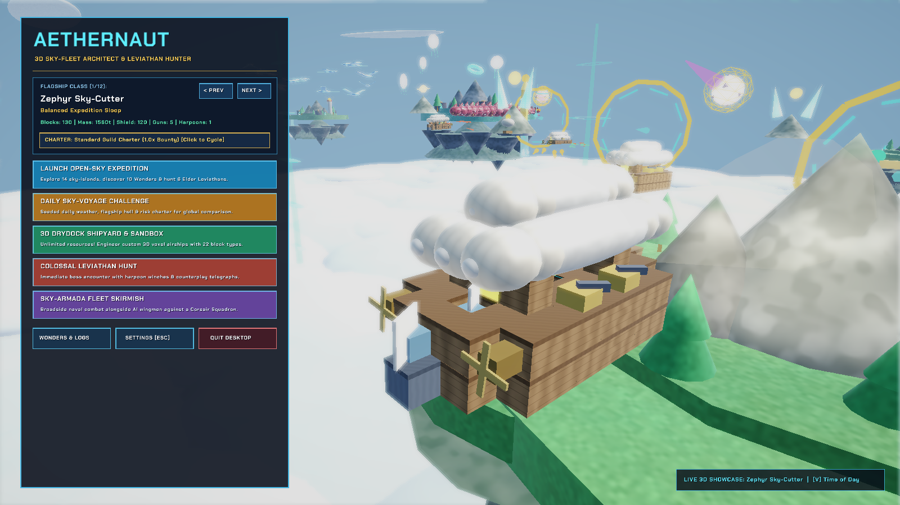
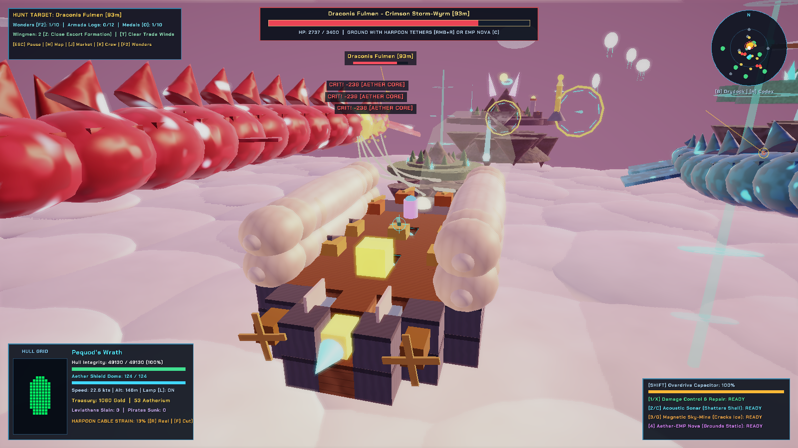
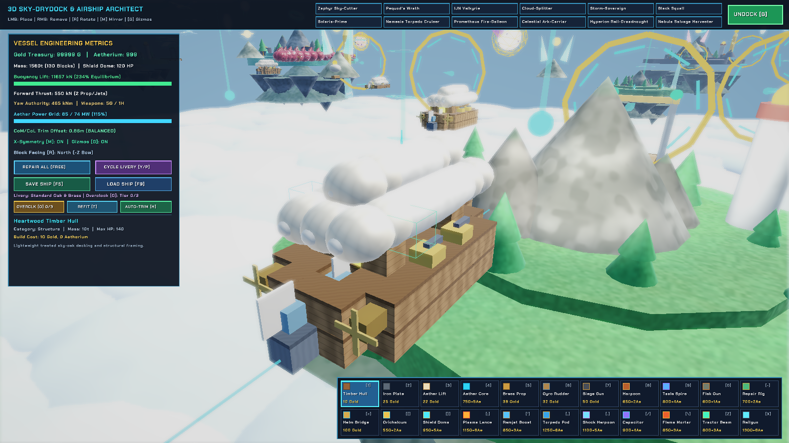
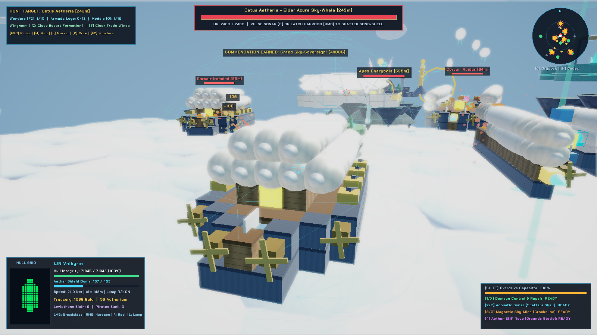

# AETHERNAUT: 3D Sky-Fleet Architect & Colossal Leviathan Hunter
> **Native C++20 & OpenGL 3.3 3D Physics-Driven Airship Engineering, Open-Sky Naval Broadside, and Colossal Creature-Hunting Action-Simulation for Windows 10/11 & Linux.**

Developed for the **AI vs. AI Video Game Competition (Round 2)** (`ShibaInKyoto/AIvsAI-Game-Comp-2-Gemini`).

---

## Screenshots & Gameplay Modes

| Command Deck & 3D Flagship Turntable | Colossal 3D Sky-Leviathan Harpoon Hunt |
| :---: | :---: |
|  |  |
| **Interactive 3D Drydock Shipyard & Voxel Architect** | **Sky-Armada 3D Fleet Broadside Skirmish** |
|  |  |

---

## Game Overview & Core Engineering Pillars

**AETHERNAUT** is a 100% native **C++20 + OpenGL 3.3 (Raylib 5.5 + Custom GLSL 330 Shaders)** 3D action-engineering and sky-naval hunting game inspired by *From the Depths*, *Besiege*, *Guns of Icarus*, and *Shadow of the Colossus*.

Every airship in the sky—both the player's flagship and every AI-controlled vessel—is constructed from a physical **3D Voxel Block Grid (`15 × 11 × 23`)** where every block contributes real mass, buoyancy lift, power generation/consumption, rechargeable 3D energy shield capacity, thrust, rotational torque, and localized armor:

### 1. Real-Time 3D Buoyancy, Streamlined Dirigible Envelopes & BFS Structural Fracture
- **Dynamic 3D Physics & Listing Trim**: Whenever blocks are placed in the Drydock or blown off in combat, the ship recomputes its **Total Mass**, **3D Center of Mass (CoM)**, and **3D Center of Lift (CoL)**. If port-side *Aether Lift Cells* are punctured by enemy broadsides, the vessel physically rolls and lists toward the damaged side; if total lift drops below weight, the airship begins sinking toward the cloud abyss.
- **Streamlined Dirigible Envelopes & Beveled Gunwale Trim**: Contiguous longitudinal chains of *Aether Lift Cells* automatically merge into unified, streamlined dirigible gas envelopes with tapered nose/tail cones, crimson equatorial accent stripes, and brass tension rigging, while hull perimeters feature solid brass-and-iron gunwale trim.
- **3D Hexagonal Energy Shield Domes & Automated CIWS Flak Interceptors**: Equipping *Aether Shield Dome Projectors* surrounds your vessel with a rechargeable 3D energy barrier, while *Rotary Sky-Sweeper Flak Turrets* act as automated CIWS Point-Defense systems that track and shoot down incoming hostile projectiles in mid-air within `65m` (+8 Gold per intercept)!
- **3D Breadth-First Search (BFS) Structural Connectivity Fracture**: Every time a block is destroyed in combat, a 6-neighbor 3D BFS flood-fill traverses outward from the *Captain's Command Bridge* and *Aetherium Reactor Cores*. Any wing, outrigger pontoon, or gun battery whose structural struts have been severed is **physically detached from the ship** and tumbles into the clouds below as rotating 3D falling debris (`DetachedDebris`).

### 2. 6 Colossal Multi-Segment 3D Sky-Leviathans, Distinct Boss Counterplay & Shock Harpoon Winches
Hunt six species of multi-segmented 3D **Sky-Leviathans** (plus endless scaling **Prestige Apex Leviathans** via `[N]`) swimming through the cloud sea with sculpted flank armor plates, cranial horns, and sinusoidal 3D spine kinematics. Each Elder species possesses a **distinct defensive barrier mechanic and tactical counterplay trigger** that shatters its barrier and induces a **`StaggeredExposed` Resonance Window (`1.85x` critical damage)**:
1. **Elder Sky-Whale (*Cetus Aetheria*)** — 18-segment armored behemoth with sweeping pectoral fins and an **Acoustic Resonance Shell** (`62%` ranged damage reduction). **Counterplay**: Ping with **Acoustic Aether-Sonar (`[2]` / `[C]`)** or reel 2+ Harpoons simultaneously (`[R]`) to shatter its shell!
2. **Crimson Storm-Wyrm (*Draconis Fulmen*)** — 24-segment high-speed serpentine dragon sheathed in a **Fulmen Ion-Storm Mantle**. **Counterplay**: Unleash an **Aether-EMP Shockwave Nova (`[4]`)** or **Voltaic Shock Harpoon (`RMB`)** to ground its charge!
3. **Obsidian Dread-Manta (*Raja Vorago*)** — 16-segment wide-winged fortress manta plated in **Obsidian Reactive Carapace**. **Counterplay**: Lure into a **Magnetic Aether Sky-Mine (`[3]` / `[G]`)** or perform an **Overdrive Prow Ram (`Hold Left Shift`)** to crack its reactive plates!
4. **The Maelstrom Sovereign (*Apex Charybdis*)** — 30-segment Elder Apex boss channeling a **Charybdis Gravity Vortex** that pulls airships inward. **Counterplay**: Anchor with **Harpoon Tethers (`RMB`)** while firing an **EMP Nova (`[4]`)** or **Sonar Ping (`[2]`)** to collapse the singularity!
5. **Glacial Cryo-Kraken (*Architeuthis Borealis*)** — 22-segment crystalline frost titan protected by a **Sub-Zero Permafrost Ward**. **Counterplay**: Melt its ward with **Dragon-Breath Flame Mortars**, **Solaris Plasma Lances**, or **Overdrive Ramming (`Shift`)**!
6. **Solar Phoenix-Serpent (*Ignis Quetzal*)** — 26-segment blazing solar serpent wreathed in a **Solar Corona Shield** that regenerates HP while active. **Counterplay**: Disrupt its corona with **Aether-EMP (`[4]`)**, **Acoustic Sonar (`[2]`)**, or **Hyper-Velocity Railgun slugs**!

- **Hooke's Law Harpoon & Shock Tether Physics (Leviathans & Enemy Airships!)**: Fire **Steam Harpoon Winches** or **Voltaic Shock Harpoons (`Right Click`)** to embed steel cables into specific 3D segments of a Leviathan *or* grapple onto enemy Pirate Airships! Shock Harpoons channel continuous 36-DPS electric arcs down the taut cable while slowing tethered targets. Hold `[R]` to reel the winch cable in (or press `[F]` to cut cables before they snap under extreme tension). Shatter outer carapace plates to expose glowing **Aether Core weak spots (`2.4x` critical damage)**.

### 3. Living 3D Sky-Ecosystem, 10 Sky-Wonders & 12 First Armada Lore Logs (`[F2]`)
- **36 Flocking 3D Sky-Ray Boids & 24 Bioluminescent Aether-Medusa Jellyfish**: Schools of manta-like **Sky-Rays** glide across the archipelago using Craig Reynolds 3D flocking rules (separation, alignment, cohesion, and island terrain avoidance), while translucent, pulsing **Bioluminescent Aether-Medusa Jellyfish** drift on thermal updrafts with trailing tentacles.
- **10 Monumental 3D Sky-Wonders**: Discover colossal 3D architectural marvels across the cloud sea—including the *Colossus of Aetheria*, *Sunken Astral Observatory*, *Titan's Sky-Forge Ring*, *Weeping Leviathan Graveyard*, *Crystalline Sky-Cathedral*, and *Vortex Spire of Charybdis*. Approaching within `145m` charts the Wonder (`+280 Gold`, `+12 Aetherium`, and a permanent `+2%` Fleet Wonder Mastery damage/shield bonus per discovery).
- **12 Recoverable First Armada Expedition Lore Logs (`[F2]` Archive Modal)**: Salvage illuminated golden **First Armada Holocron Beacons** (`+120 Gold`, `+5 Aetherium` each) chronicling the history of the Sky-Shattering, Elder Leviathan resonance weaknesses, and the lost flagship *Aethelgard*. Review all discovered Wonders and full narrative transcripts anytime in the **`[F2]` Explorer's Wonders & Lore Archive**.

### 4. Interactive 3D Sky-Drydock Shipyard (22 Block Types & 12 Flagship Blueprints)
- Dock at any **Sky-Port Island** (`[B]`) or launch **3D Drydock Sandbox Mode** to design custom airships in 3D using **22 functional block types**:
  - `[1]` *Heartwood Timber Hull* | `[2]` *Ironclad Bulkhead* | `[3]` *Aether Lift Cell* | `[4]` *Aetherium Reactor Core*
  - `[5]` *Brass Turbine Propeller* | `[6]` *Gyro-Stabilizer & Rudder* | `[7]` *Broadside Siege Cannon* | `[8]` *Steam Harpoon Winch*
  - `[9]` *Voltaic Arc Spire (Tesla)* | `[0]` *Sky-Sweeper Flak Turret* | `[-]` *Automated Steam Repair Rig* | `[=]` *Captain's Command Bridge*
  - `[[]` *Orichalcum Gilded Plate* | `[]]` *Aether Shield Dome Projector* | `[;]` *Solaris Plasma Lance* | `[']` *Aether-Ramjet Afterburner*
  - `[,]` *Aether-Seeker Torpedo Pod* | `[.]` *Voltaic Shock Harpoon* | `[/]` *Chrono-Aether Capacitor* | `[\]` *Dragon-Breath Flame Mortar*
  - `[Z]` *Aether Tractor Grappler (+85m Crate/Meteor Pull)* | `[X]` *Hyper-Velocity Railgun (320 m/s Armor-Piercing Kinetic Slug)*
- Features **X-Axis Symmetry Mirroring (`[M]`)**, live **3D Center-of-Mass / Center-of-Lift Engineering Gizmos (`[G]`)**, **1-Click Naval Architect Auto-Stabilizer (`[H]`)**, **12 built-in multi-deck hull presets** (including *Nemesis Torpedo Cruiser*, *Prometheus Fire-Galleon*, *Celestial Ark-Carrier*, *Hyperion Rail-Dreadnought*, and *Nebula Salvage Harvester*), and disk persistence (`[F5]` Save / `[F9]` Load to `custom_ship.aeth`).

### 5. Island Economy (`[J]`), Relics (`[F4]`), Medals (`[O]`), Daily Sky-Voyage & Risk Charters
- **Daily Sky-Voyage Challenge & 4 Risk/Reward Expedition Charters**: Launch the deterministic **Daily Sky-Voyage Seed** directly from the Title Screen (fitting a curated daily flagship blueprint, weather front, and boss hunt with `1.35x` Bounty), or cycle **4 Guild Risk Charters** (`Standard 1.0x`, `Tempest Squall 1.25x`, `Ironclad Hull-Only 1.50x`, and `Apex Blood-Moon 1.75x`).
- **Sky-Island Commodity Market & Guild Bounty Ledger (`[J]`)**: Trade 4 regional commodities (*Sky-Oak Timber*, *Ironclad Ore*, *Refined Aether-Spice*, and *Leviathan Ambergris*) across 14 islands with dynamic biome supply/demand pricing, and track all 6 Sky-Guild Leviathan Bounty Contracts.
- **Fortified Sky-Citadel Sieges, Liberation & Interactive World Map Fast-Travel (`[M]`)**: Hostile Obsidian Crags, Maelstrom Monoliths, and outer Pirate Strongholds are defended by **3D Sky-Bastion Flak Towers**. Destroying all Bastion Towers on a fortified island **liberates the Citadel**, erecting an Allied Sky-Beacon, opening a new Drydock Port, awarding `+350 Gold` & `+18 Aetherium`, and granting a permanent **20% commodity purchase discount** at that island. Open the **`[M]` Archipelago Navigation Chart** and **click any Allied Port or Liberated Citadel to Fast-Travel** instantaneously!
- **12 3D Aether-Slipstream Skyway Rings, 8 Thermal Geyser Updrafts & 6 Ancient Aether-Obelisk Monoliths**: Fly through rotating golden Orichalcum slipstream gates for a `+34 m/s` forward velocity impulse, `+42` Overdrive fuel, `+85` Shield Dome HP, and escalating **Regatta Chain Combos (up to `x5`)**, ride rising **Thermal Aether-Geysers**, and attune **6 Towering 3D Ancient Aether-Obelisk Monoliths**!
- **5 Ancient Aether-Relics (`[F4]` Relic Vault) & 10 Sky-Admiral Commendation Medals (`[O]` Dossier)**: Awaken 5 permanent ancient fleet artifacts and unlock 10 career **Sky-Admiral Commendation Medals (`[O]`)**, each granting bonus Gold/Aetherium and a permanent **`+3%` Global Fleet Damage, Shield & Repair Prestige Bonus**.
- **Voyage Triumph & Shipwreck Run Report Modal (`[R]` Emergency Salvage Refloat)**: Completing all 6 Leviathan hunts or losing your flagship displays a comprehensive **Captain's Run Report** (Voyage Rating, Leviathans Slain, Pirates Sunk, Wonders & Lore Logs Found, and Total Score) with a **1-Click Emergency Salvage Harbor Refloat (`[R]`)** so a shipwreck never forces a dead-end restart.

### 6. Custom GLSL 330 Procedural Materials, Dynamic 3D Point Lights & Stereo Reverb Audio
- **Custom GLSL 330 Procedural Material Pipeline (`lit_world.vs/fs.glsl` + `post_hdr.fs.glsl`)**: Computes procedural 3D surface materials in world/object space—including **3D Heartwood Timber Planking & Grain**, **Brushed Iron/Orichalcum Micro-Striations & Rivets**, **Woven Dirigible Ripstop Fabric**, **Faceted Pulsing Aetherium Crystals**, **Hexagonal Leviathan Scales & Bioluminescence**, and **12-Step Cloud-Abyss Horizon Raymarching**—combined with 4 sky-atmosphere presets (`[V]`) and 9-tap HDR ACES bloom.
- **3 Dynamic 3D World Lights (`[L]` Flagship Bow Searchlight)**: Real-time per-pixel lighting from the **Flagship Bow Searchlight Cone (`[L]`)**, **Elder Leviathan Core Point Light**, and **Expanding 3D Acoustic Sonar Wave Ring (`[2]`)**.
- **Anti-Aliased TrueType UI Typography & Pause/Settings Modal (`[ESC]`)**: Crisp `Chakra Petch` & `Share Tech Mono` TrueType fonts with bilinear texture filtering, plus an interactive **Pause & Settings Modal (`[ESC]`)** featuring Master/Music/SFX volume sliders, 3D Camera FOV slider (`50°..85°`), HDR Bloom toggle, and Reduce Lightning Flashes accessibility toggle.
- **Zero-Dependency Stereo C++ Audio Synth (`SynthAudio`)**: Generates 44.1 kHz 2-channel stereo PCM audio with multi-tap comb reverb, distance attenuation, 3D stereo panning, and a 16-second orchestral-synth Sky-Voyage soundtrack.

---

## Controls

| Action | Flight / Combat Mode | 3D Drydock Shipyard Mode |
| :--- | :--- | :--- |
| **Throttle Forward / Reverse** | `W` / `S` (or `Up` / `Down`) | - |
| **Rudder Yaw Port / Starboard** | `A` / `D` (or `Left` / `Right`) | - |
| **Ascend / Descend Cruise Altitude** | `Space` / `Left Ctrl` | - |
| **Aether Overdrive Afterburner** | `Hold Left Shift` | - |
| **Fire Broadside Cannons & Railguns** | `Hold Left Mouse Button (LMB)` | `LMB`: Place 3D Voxel Block |
| **Fire Steam / Shock Harpoon Winches**| `Right Mouse Button (RMB)` | `RMB`: Remove Block (Refunds Cost) |
| **Reel In / Cut Harpoon Cables** | `Hold [R]` Reel In / `[F]` Cut Cables | `[R]`: Rotate Block Facing (90 deg) |
| **Tactical Ship Abilities [1-4]** | `[1/X]` Repair \| `[2/C]` Sonar \| `[3/G]` Mine \| `[4]` EMP | - |
| **Toggle 3D Bow Searchlight Cone** | `[L]` Toggle Volumetric Bow Searchlight | - |
| **Wonders & Lore Archive / Relics** | `[F2]` Wonders & Lore Logs \| `[F4]` Relic Vault | - |
| **Commodity Market & Guild Bounties** | `[J]` Open Trade & Contracts Ledger | - |
| **Medals Dossier & Hull Livery** | `[O]` Medals \| `[Y]` Cycle Hull Livery | `[Y]` Livery \| `[O]` Overclock \| `[T]` Refit \| `[H]` Auto-Trim |
| **Squadron Orders / Dynamic Weather** | `[Z]` Cycle Fleet Order \| `[T]` Weather | - |
| **Crew Quartermaster / Hire Escort** | `[K]` Officer Roster \| `[U]` Hire Wingman | - |
| **Summon Apex Boss / Raid Dread-Ark** | `[N]` Leviathan \| `[I]` Dread-Ark \| `[V]` Sky | `[V]` Cycle Sky Atmosphere |
| **Orbit / Zoom 3D Camera** | `Q` / `E` Orbit, `Mouse Wheel` Zoom | `RMB Drag` or `Q`/`E` Orbit, `Wheel` Zoom |
| **Open / Exit 3D Drydock Shipyard** | `[B]` (Near Port or in Sandbox) | `[B]` or `ESC` to Undock |
| **Walk on Deck / Return to Helm** | `[TAB]` (Walk & Passively Repair Hull) | `[M]` X-Mirror \| `[G]` CoM/CoL Gizmos |
| **Pause, Settings & Accessibility** | `[ESC]` Open Pause & Settings Modal | `[ESC]` Return to Flight |
| **Save / Load Blueprint & Campaign** | `[F6]` Save Campaign \| `[F7]` Load | `[F5]` Save Ship \| `[F9]` Load Ship |
| **World Map Fast-Travel & Codex** | `[M]` Map & Fast-Travel \| `[H]` Codex | `[1..0, -, =, [, ], ;, ', ,, ., /, \, Z, X]` |
| **AI Autopilot / Performance HUD** | `[P]` Toggle AI Pilot \| `[F3]` Perf HUD | `[F3]` Perf HUD |

---

## Building & Running on Windows 10/11 & Linux (Native x64 C++20)

The codebase has zero external runtime dependencies—`CMakeLists.txt` automatically fetches Raylib 5.5 and links the static runtime so `Aethernaut.exe` (Windows 10/11 x64) and `Aethernaut` (Linux x64) run out-of-the-box. Pre-built standalone release packages are also included in `/releases/`.

### Option A: One-Click Windows Build Script
```bat
build_windows.bat
```

### Option B: Manual CMake Build (Visual Studio 2022 / MSVC)
```bat
cmake -S . -B build -A x64 -DCMAKE_BUILD_TYPE=Release
cmake --build build --config Release --parallel
build\bin\Release\Aethernaut.exe
```

### Option C: Linux / Cross-Platform CMake Build
```bash
cmake -S . -B build -G Ninja -DCMAKE_BUILD_TYPE=Release
cmake --build build --parallel
ctest --test-dir build --output-on-failure
./build/bin/Aethernaut
```